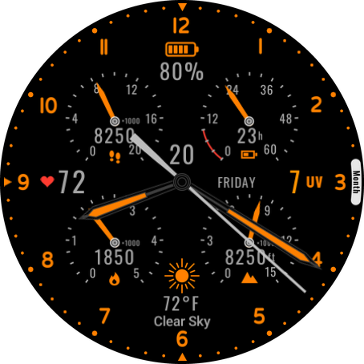
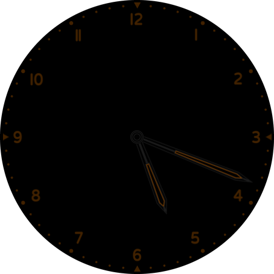

# Night Dial for Wear OS

Analog watch face for the Google Pixel Watch 5 (Wear OS 7). It runs on any round Wear OS 6 or
later watch.

It is built with the [Watch Face Format](https://developer.android.com/training/wearables/wff)
(version 4), which Google requires for watch faces.

<p align="center">
  
  
</p>

*The Wear OS 7 emulator. Left: the test build (`./build.sh test`) at its fixed time of
8:20:22, with its sample readings (72°F and clear, UV 7, 80% battery, 23 hours left, 8,250
steps, 1,850 calories, 8,250 ft, a heart rate of 72, Friday the 20th of March). Right:
always-on mode.*

## The face

- **Dial:** an orange ring at the edge of the face: a dot for every minute, larger at the
  hours, and a triangle pointing inward at 12, 3, 6 and 9. Small orange hour numerals 1 to
  12 sit just inside it.
- **Hands:** slim dark hour and minute hands with straight sides that widen out from the
  hub to a point, a gray outline, a bordered orange insert and a gray center bar; a light
  gray seconds hand with a counterweight, ending just inside the ring; and a small black
  hub with three gray rings.
- **Readings:** the values (gauges, battery, temperature, heart rate, UV and date) are in
  gray Oswald and show "--" without data.
- **Date:** the day of the month above the hub, and the day's full name (SUNDAY to
  SATURDAY) right of it, between the hub and the UV index.
- **Weather:** above the 6, between the bottom gauges, from the watch's weather data: an
  orange icon for the condition (night versions after dark), the temperature (red above
  90°F, blue below 40°F) and the condition's name. Without weather data, the sun and "--°".
- **Heart rate:** right of the 9: a red heart above the rate, from the watch's heart rate
  sensor.
- **UV index:** left of the 3, mirroring the heart rate: an orange "UV" above the index, in
  the WHO scale's colors (green, yellow, orange, red, violet).
- **Battery:** at the top: the percentage, and below it an orange battery with a segment
  lit for every 20% (rounded up). Both turn red below 20%.
- **Gauges:** four rings of gray tick marks, open at the bottom, each with its value large
  in the middle and its orange icon below. The value is as large as fits its digits: up to
  three digits at the largest size, four and five smaller, so 25,000 steps still fit. A
  unit, if any, sits small above the value.
  - **Battery time** (1:30): the hours of battery left, with an "h" above and a red band
    through the ticks from 0 to 9 h. They come from DataDial Stats, which measures how fast
    the battery has been draining since it was last unplugged (DataDial 1.0.4 or later);
    while charging, or before it has seen the battery drop a couple of percent, "--".
  - **Steps** (10:30): today's steps, in green once they reach the step goal, with
    footprints. They come from the Google Health app's steps complication, as on DataDial.
  - **Calories** (7:30): today's calories, with a flame. Watch Face Format can't read
    calories itself, so they come from the Google Health app's calories complication, as on
    DataDial.
  - **Elevation** (4:30): the elevation in feet, with "ft" above and a mountain. It comes
    from DataDial's companion app, DataDial Stats (barometric elevation), which must be
    installed on the watch. DataDial Stats sends meters in regions that use metric units,
    which this gauge doesn't read.
- **Month:** a light gray band on the ring over the current month's numeral (1 for January
  to 12 for December), from the minute dot before it to the one after, with "Month" in
  black along it.
- **Always-on mode:** the dimmed ring and numerals, and the hour and minute hands with
  their orange hollowed out to an outline; no seconds hand, readings, gauges or month.

## How it's built

Watch Face Format is declarative XML with no code. The layout is computed from the screen
radius, so `tools/generate.py` writes the XML and renders the images with Pillow: each is
drawn large, saved as a master in `build/masters/` for review, and scaled down to screen
size. Edit the script, not the generated files.

| File | Purpose |
|---|---|
| `tools/generate.py` | Writes `res/raw/watchface.xml` and the images in `res/drawable/` |
| `tools/fonts/` | Varela Round for the hour numerals, and Oswald for the gauges and readings (both SIL Open Font License) |
| `build.sh` | Generate, build, install, test build, runtime log |
| `watchface/src/main/AndroidManifest.xml` | Package, Watch Face Format version 4, no code |
| `watchface/src/main/res/raw/watchface.xml` | The watch face (generated) |
| `watchface/src/main/res/xml/watch_face_info.xml` | Preview image and picker settings |
| `watchface/src/main/res/values/strings.xml` | Names shown in the picker and editor |
| `watchface/src/main/res/drawable/preview.png` | Picker and store preview (an emulator capture of the test build) |
| `docs/face.png`, `docs/face-ambient.png` | The pictures above (emulator captures of the test build, awake and in always-on mode) |

## Build

Needs Android Studio (for its JDK; the Android SDK with API 36 platform and build tools), and
Python 3 with Pillow.

```sh
./build.sh          # generate and build the debug APK
./build.sh run      # also install it on the watch or emulator and make it the active face
./build.sh test     # the same with the hands frozen and sample weather, UV, battery, date, month, heart rate, steps, calories, elevation and battery time, to check the layout
./build.sh release  # release bundle (.aab) for Google Play (set up release signing first)
./build.sh log      # the watch face runtime's log: XML and expression errors show up here
```

`./build.sh test` writes the normal XML back when it's done, so the frozen hands never stay
in the source. Run `./build.sh run` afterwards to put the live face back on the watch.

The project also opens in Android Studio, which checks the watch face XML as you edit it.

## Run on the emulator or the watch

- **Emulator:** create a Wear OS 7 large round device (Device Manager in Android Studio, or
  `avdmanager create avd -k "system-images;android-37.0;android-wear-signed;x86_64" -d wearos_large_round`),
  start it, then `./build.sh run`.
- **Pixel Watch 5:** turn on Developer options (Settings → System → About → Versions, tap
  Build number seven times), then Developer options → Wireless debugging → Pair new device.
  On the PC: `adb pair <ip>:<port>` with the shown code, then `adb connect <ip>:<port>` with
  the port shown on the Wireless debugging screen, and `./build.sh run`.

A watch face changed with `./build.sh run` keeps its settings. To get the defaults again,
uninstall it first (`adb uninstall io.github.ls6777.nightdial`).
